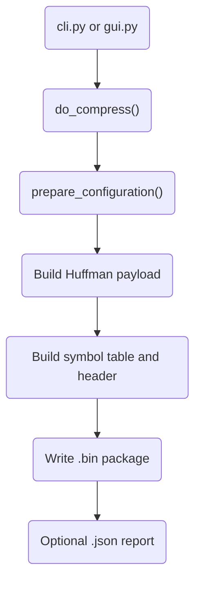

# Q-HUFDEL Compression

## [do_prepare](do_prepare.py)

This script is used to generate the difference between two quantized model file.

### Basic Usage:

```bash
# Process and combine into single CSV
python do_prepare.py -f ./models -n LeNet_300_100 --combine

# With custom step and combine
python do_prepare.py -f ./models -n LeNet_300_100 -s 2 --combine

# Full options
python do_prepare.py -f ./models -n LeNet_300_100 -s 5 -o ./results --combine
```

### Output

#### Individual CSV files (always created):

```
diff_and_freq_1_2.csv
diff_and_freq_2_3.csv
diff_and_freq_3_4.csv
...
```

Each contains:

```csv
value,frequency
-255,0
-254,5
...
0,45000
1,8234
...
255,2
```

#### Combined CSV file (created with `--combine`):

**Filename:** `{model_name}_step_{x}.csv`

Example: `LeNet_300_100_step_1.csv`

```csv
value,freq_1_2,freq_2_3,freq_3_4,freq_4_5,freq_5_6
-255,0,0,0,0,0
-254,5,3,7,2,0
-253,12,8,15,10,5
...
-1,234,456,789,123,345
0,45000,44000,46000,45500,44800
1,8234,9123,7845,8901,8567
2,156,234,189,167,201
...
253,0,1,0,0,2
254,3,2,1,0,1
255,0,0,0,0,0
```

**Column structure:**

- `value`: Difference values from -255 to 255
- `freq_{i}_{j}`: Frequency for comparison between model i and model j

### Complete example

Given models: `LeNet_300_100_1.h`, `LeNet_300_100_2.h`, ..., `LeNet_300_100_10.h`

#### Consecutive pairs with combine

```bash
python do_prepare.py -f ./models -n LeNet_300_100 --combine
```

Creates individual files from `diff_and_freq_1_2.csv` through
`diff_and_freq_9_10.csv`, plus `LeNet_300_100_step_1.csv` containing columns
from `freq_1_2` through `freq_9_10`.

#### Every 2nd model with combine

```bash
python do_prepare.py -f ./models -n LeNet_300_100 -s 2 --combine
```

Creates comparisons such as `diff_and_freq_1_3.csv` and
`diff_and_freq_8_10.csv`, plus `LeNet_300_100_step_2.csv`.

#### Every 5th model with combine

```bash
python do_prepare.py -f ./models -n LeNet_300_100 -s 5 --combine
```

Creates comparisons such as `diff_and_freq_1_6.csv` and
`diff_and_freq_5_10.csv`, plus `LeNet_300_100_step_5.csv`.

## do_huffman

This script creates the Huffman compression configuration by finding the
optimal merge threshold and generating a codebook for the remaining values.

- [Normal Huffman](do_huffman_norm.py)
- [Canonical Huffman](do_huffman_canonical.py)

```bash
python do_huffman.py -f diff_1_2.csv -o results
```

## Package generation

`cli.py` and `gui.py` are the user-facing entry points. Both call
`do_compress.do_compress()`, which automatically prepares the Huffman
configuration, builds the delta payload, writes the package, and optionally
creates a JSON report.

### Requirements

- Python 3.8+
- Dependencies listed in `requirements.txt`

Install dependencies if needed:

```bash
pip install -r requirements.txt
```

## Command-line usage

Run the CLI from the `encoder` directory:

```bash
python cli.py <name> <header1> <version1> <header2> <version2> [options]
```

Arguments:

| Argument | Description |
| --- | --- |
| `name` | Output name without a folder or extension |
| `header1` | Current/source model C header file |
| `version1` | Version number of the source model |
| `header2` | Update/target model C header file |
| `version2` | Version number of the target model |
| `-o`, `--output` | Output folder; defaults to the folder containing `header1` |
| `--merge-from` | First merge index to test; must be used with `--merge-to` |
| `--merge-to` | Exclusive upper merge index; must be used with `--merge-from` |
| `--json-report` | Write a JSON report next to the generated package |

Example:

```bash
python cli.py LeNet LeNet_9-quantized.h 9 LeNet_10-quantized.h 10
```

With an output folder and JSON report:

```bash
python cli.py LeNet \\
    ./models/LeNet_9-quantized.h 9 \\
    ./models/LeNet_10-quantized.h 10 \\
    --output ./compressed_output \\
    --json-report
```

To limit the merge-index search range:

```bash
python cli.py LeNet \\
    ./models/LeNet_9-quantized.h 9 \\
    ./models/LeNet_10-quantized.h 10 \\
    --merge-from 256 \\
    --merge-to 511
```

The generated package is named `<name>_<version1>_<version2>.bin`.

### CLI executable help

When `cli.py` is built as an executable, `argparse` provides the help option
automatically:

```powershell
qhufdel-cli.exe --help
```

The same help is available when running the Python file directly:

```powershell
python cli.py --help
```

## GUI usage

Start the Tkinter GUI from the `encoder` directory:

```bash
python gui.py
```

The GUI entry point also accepts `--help` and exits after printing its usage:

```powershell
qhufdel-gui.exe --help
python gui.py --help
```

Run the GUI executable without arguments to open the application:

```powershell
qhufdel-gui.exe
```

If the GUI executable is built with PyInstaller, build it with a console when
you want to see `--help` output in a terminal. A `--windowed` build can still
accept the option, but it has no console in which to display the text.

Typical PyInstaller commands are:

```powershell
pyinstaller --onefile --name qhufdel-cli cli.py
pyinstaller --onefile --name qhufdel-gui gui.py
```

Fill in the name, source and target headers, versions, and an existing output
folder. The optional merge bounds must be supplied together. Enable
**Generate JSON report** to create a report beside the package, then select
**Run**. Progress and backend output are shown in a separate window while the
GUI remains responsive.

## Backend workflow



Notes:

- `header1` is the **base/source** model.
- `header2` is the **target/update** model.
- Huffman configuration is generated automatically for each compression run.
- `do_compress.py` is the shared backend module; use `cli.py` or `gui.py` for normal operation.
